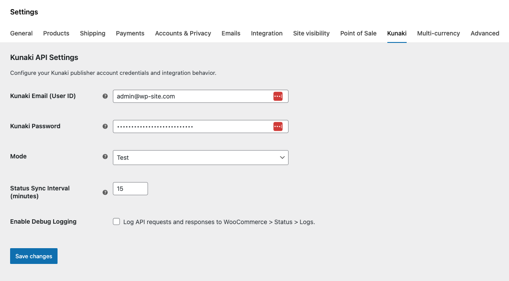
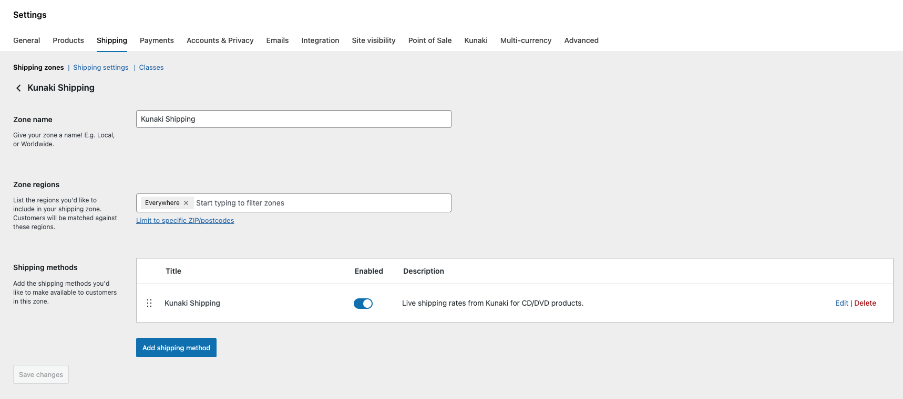
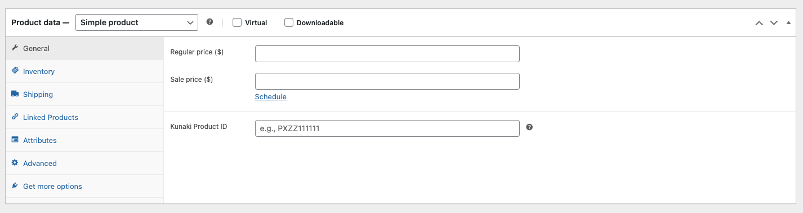

# Kunaki WooCommerce

[](https://github.com/nickmendoza/kunaki-woocommerce/actions/workflows/ci.yml)

Reliable [Kunaki](https://kunaki.com) disc fulfillment for WooCommerce -- live shipping rates, idempotent order submission, and concurrency-safe tracking synchronization.

## Why This Plugin Exists

Kunaki manufactures and ships CDs, DVDs, and Blu-ray discs on demand. Their integration surface is a stateless XML API with no webhooks, no order deduplication, and no delivery callbacks. Every order submitted is manufactured. There is no undo. In production stores, even a single duplicate submission represents real manufacturing cost and customer confusion.

This creates a set of problems that naive implementations get wrong:

- **Double submissions.** WooCommerce fires `woocommerce_order_status_processing` on every transition to "processing." Payment gateways, admin actions, and webhook retries can all trigger it concurrently. Without locking, the same order gets manufactured twice.
- **Lost tracking numbers.** Kunaki provides tracking data only through status polling. Without a reliable sync loop, customers never receive shipping confirmation.
- **Duplicate emails.** If the status sync runs concurrently (overlapping cron executions), the same tracking note gets added twice, sending the customer two identical emails.
- **Mixed carts.** Orders containing both Kunaki and non-Kunaki products need partial fulfillment -- only the disc items go to Kunaki, and the order should not auto-complete until the store owner handles the rest.

This plugin addresses these concerns through atomic locking, idempotent submission, save-before-notify ordering, and per-order concurrency control.

## Features

- **Live Shipping Rates** -- Real-time Kunaki shipping options and prices at checkout, cached via transients.
- **Idempotent Order Submission** -- Orders are submitted to Kunaki exactly once, protected by atomic locks and multi-layer duplicate prevention.
- **Order Tracking** -- Cron-based polling syncs Kunaki status and emails customers their tracking number.
- **Product Linking** -- Link any WooCommerce product to a Kunaki disc via its 10-character Product ID.
- **Mixed Cart Handling** -- Submits only Kunaki items; defers order completion when non-Kunaki items are present.
- **Retry Queue** -- Admin page listing failed submissions with error details, attempt counts, and one-click retry buttons. Per-order retry on the order edit page.
- **HPOS Compatible** -- Declares compatibility with WooCommerce High-Performance Order Storage.
- **Automatic Retry** -- Failed submissions are retried automatically via cron with linear backoff and a configurable attempt limit.
- **Credential Encryption** -- Passwords encrypted at rest with AES-256-GCM.

## Requirements

- WordPress 5.8+
- WooCommerce 6.0+
- PHP 7.4+ with OpenSSL extension

## Installation

1. Download `kunaki-woocommerce-x.x.x.zip` from the [latest GitHub release](https://github.com/nickmendoza/kunaki-woocommerce/releases/latest) (under **Assets**, not the auto-generated "Source code" archives).
2. In WordPress, go to **Plugins > Add New > Upload Plugin** and upload the ZIP.
3. Activate the plugin.
4. Navigate to **WooCommerce > Settings > Kunaki** and enter your Kunaki publisher email and password. Set mode to **Test** for development or **Live** for production.
5. Under **WooCommerce > Settings > Shipping > Shipping Zones**, add "Kunaki Shipping" as a shipping method to the appropriate zone(s).
6. Edit any WooCommerce product and enter its Kunaki Product ID in the General tab.

### Screenshots

**Settings** -- Configure credentials, mode, sync interval, and debug logging under WooCommerce > Settings > Kunaki.



**Shipping Zone** -- Add Kunaki Shipping as a method in any WooCommerce shipping zone for live rates at checkout.



**Product Linking** -- Enter the 10-character Kunaki Product ID on any product's General tab.



### Settings

| Setting | Description |
|---------|-------------|
| Kunaki Email | Your Kunaki publisher account email |
| Password | Your Kunaki account password (encrypted at rest) |
| Mode | `Test` (no real orders manufactured) or `Live` (production) |
| Sync Interval | How often to poll Kunaki for status updates (default: 15 min, range: 5--1440 min) |
| Max Retry Attempts | Maximum total attempts for a failed submission before requiring manual intervention (default: 3, range: 1--10) |
| Debug Logging | Log full API requests/responses (credentials redacted) to WooCommerce > Status > Logs |

## Architecture Overview

The plugin is organized into nine single-responsibility components, coordinated by a singleton orchestrator. No component performs direct SQL outside controlled locking primitives.

```
kunaki-woocommerce.php                   Bootstrap, constants, encryption filters, cron setup
includes/
  class-kunaki-woocommerce.php           Orchestrator: loads components, registers hooks
  class-kunaki-api-client.php            Stateless XML API client (shipping, orders, status)
  class-kunaki-shipping-method.php       WC_Shipping_Method: live rates with transient caching
  class-kunaki-order-fulfillment.php     Event-driven order submission with atomic locking
  class-kunaki-order-status-sync.php     Cron-based status polling with per-order locks
  class-kunaki-retry-queue.php           Failed order admin page with manual retry
  class-kunaki-product-meta.php          Product editor field, validation, admin column
  class-kunaki-settings.php              WooCommerce settings tab
  class-kunaki-logger.php                Log wrapper with debug gating
  encryption.php                         AES-256-GCM encrypt/decrypt helpers
uninstall.php                            Option cleanup on plugin deletion
```

### Event-Driven Order Submission

Order submission is triggered by the `woocommerce_order_status_processing` hook. The fulfillment handler collects Kunaki-linked line items, resolves the shipping description stored at checkout, maps the shipping address to Kunaki's format, and submits via the API client. The API client is stateless and injectable -- it reads credentials from `wp_options` by default but accepts constructor overrides for testing.

### Cron-Based Status Polling

A WP-Cron event (`kunaki_wc_sync_order_status`) runs on a configurable interval (default: 15 minutes, range: 5--1440). It queries all WooCommerce orders in "processing" status that have a stored Kunaki Order ID, polls the Kunaki API for each, and handles status transitions: SHIPPED triggers tracking delivery and optional auto-completion, DECLINED moves the order to on-hold, and intermediate statuses (PROCESSING, APPROVED, PENDING) log admin notes.

### Performance Considerations

- Status polling queries only orders in "processing" status with a stored Kunaki Order ID -- not the full order table.
- Locks are short-lived and self-cleaning; expired locks are pruned atomically before each acquisition attempt.
- Shipping rates are cached via transients (30-minute TTL) to minimize outbound API calls during checkout.

### Separation of Concerns

The API client knows nothing about WooCommerce orders. The status sync knows nothing about order submission. The fulfillment handler owns both event-driven submission and cron-based retry, but knows nothing about status polling. Each component is independently testable and interacts only through order meta and the API client interface.

## Reliability and Concurrency Guarantees

### Atomic Locking

Both order submission and status sync acquire per-order locks using `INSERT IGNORE` into `wp_options`. This is a single atomic SQL statement -- only one process wins the insert. Locks carry an expiry timestamp. Before acquiring, expired locks are cleaned up with a `DELETE WHERE option_value < NOW()` query (also atomic, no SELECT-then-DELETE race).

- Submission locks expire after 5 minutes.
- Sync locks expire after 2 minutes.

### Idempotent Submission

Order submission is protected by four layers:

1. **Meta check** -- `_kunaki_submitted = yes` in order meta skips immediately.
2. **Fallback marker check** -- If a previous submission succeeded at Kunaki but `$order->save()` failed catastrophically, a durable marker in `wp_options` preserves the Kunaki Order ID. On the next trigger, the marker is detected, meta is restored, and the order is not resubmitted.
3. **Atomic lock** -- `INSERT IGNORE` ensures only one concurrent process proceeds.
4. **Post-lock re-check** -- After acquiring the lock, the order is reloaded from the database to catch any submission that completed between the initial check and lock acquisition.

### Failure Recovery

If the Kunaki API accepts an order but `$order->save()` throws, the plugin attempts `$order->save_meta_data()` as a narrower fallback. If that also fails, a durable marker (`_kunaki_submitted_{order_id}`) is written directly to `wp_options` via `INSERT IGNORE`, storing the Kunaki Order ID. This marker survives lock expiration and prevents resubmission on any subsequent trigger. If even the marker write fails, the lock is deliberately retained to block further attempts until manual intervention.

### Automatic Retry

When the Kunaki API returns an error or the HTTP request fails, the plugin records structured failure metadata on the order (error message, timestamp, attempt count) and releases the lock. A separate WP-Cron event (`kunaki_wc_retry_failed_orders`) runs on the same interval as the status sync and retries eligible orders automatically.

- **Linear backoff** -- Each retry waits `attempts * 15 minutes` since the last failure before retrying.
- **Configurable limit** -- After the configured max attempts (default: 3), the order is marked exhausted and an order note alerts the admin.
- **Durable failure markers** -- If failure metadata fails to persist (e.g., database instability), a `_kunaki_failed_{order_id}` marker is written to `wp_options`. The retry cron recovers these orphaned markers at the start of each run.
- **Idempotent** -- Retries go through the same `handle_order_processing` path with its full locking and deduplication guarantees.

### Email Duplication Prevention

The status sync saves all meta and status changes via `$order->save()` before adding any customer-facing order notes. If `save()` fails, no notes are persisted and the next cron run retries from a clean state. To handle the crash window between a successful `save()` and `add_order_note()`, pending notes are stored in order meta atomically with the status change. If the process dies after save but before the note is sent, the next cron run detects the pending note, delivers it, and clears the flag.

All critical state transitions are deterministic and replay-safe.

## Security Considerations

### Encryption at Rest

The Kunaki password is encrypted using AES-256-GCM before storage in `wp_options`. The encryption key is derived from WordPress's `AUTH_SALT` via SHA-256. Each encryption generates a fresh 12-byte random nonce. The stored value is `base64(nonce || tag || ciphertext)`.

A legacy AES-256-CBC decryption path exists for passwords encrypted before the GCM upgrade. If both decryption methods fail (typically after salt rotation during site migration), the plugin sets a persistent flag and displays an admin notice prompting the user to re-enter their password.

Encryption and decryption are applied transparently via `pre_update_option` and `option_{name}` filters. No plaintext password is stored in the database at any point after initial save.

### Credential Handling

- Credentials appear in API payloads only for authenticated operations (order submission and status polling). Shipping rate lookups are unauthenticated.
- All API request/response logging automatically redacts `<UserId>` and `<Password>` XML elements before writing to the WooCommerce log.
- The settings page renders the password field as `type="password"`.

## Testing Strategy

The test suite runs entirely outside WordPress. No WordPress installation, no database, no WooCommerce runtime. All WordPress and WooCommerce functions are stubbed using [Brain Monkey](https://github.com/Brain-WP/BrainMonkey), and object dependencies are mocked with [Mockery](https://github.com/mockery/mockery).

This isolation strategy means tests execute in seconds, run in CI without infrastructure, and validate plugin logic without conflating it with WordPress behavior.

115 unit tests cover:

| Area | What's Validated |
|------|-----------------|
| API Client | XML request construction, response parsing, HTTP error handling, HTML-wrapped response extraction, credential injection |
| Order Fulfillment | Duplicate submission prevention across all four layers, atomic lock acquisition and release, meta storage, mixed cart detection, fallback marker recovery, failure meta recording and cleanup, auto-retry with backoff, exhaustion handling, orphaned failure recovery, retry logic |
| Order Status Sync | SHIPPED/DECLINED/PENDING transitions, tracking info extraction, auto-completion logic for pure-Kunaki vs. mixed orders, save-before-notify ordering |
| Shipping Method | Rate calculation, Kunaki product filtering, transient cache hit/miss, state/province handling for US/CA vs. international, country name resolution |
| Product Meta | 10-character alphanumeric validation, capability checks, admin column rendering, safe handling of absent POST fields |
| Logger | Debug gating based on settings, log level routing |
| Retry Queue | AJAX handler permission and input validation, `prepare_for_retry` guard clauses, admin page hook registration |
| Encryption | AES-256-GCM round-trip, AES-256-CBC legacy fallback, invalid/corrupt input handling |

```bash
composer install
composer test
```

Run a specific test file or filter by name:

```bash
composer test -- tests/Unit/APIClientTest.php
composer test -- --filter "shipped"
```

## Roadmap

These are planned or under consideration. No guarantees on timeline.

- **Webhook receiver** -- If Kunaki adds push notifications for status changes, replace polling with a webhook endpoint to eliminate sync latency.
- **Bulk status sync CLI command** -- WP-CLI command for on-demand sync of all pending orders, useful for debugging and migration recovery.
- **Admin dashboard widget** -- Summary of pending, shipped, and declined Kunaki orders at a glance.
- **Structured logging** -- JSON log format with order ID indexing for easier parsing in external log aggregators.

## Contributing

Contributions are welcome. Please open an issue before submitting a pull request for non-trivial changes.

```bash
composer install
composer test
```

All pull requests must pass the existing test suite. New features should include corresponding tests.

## License

This program is free software: you can redistribute it and/or modify it under the terms of the GNU General Public License as published by the Free Software Foundation, either version 2 of the License, or (at your option) any later version.

See the [GNU General Public License v2.0](https://www.gnu.org/licenses/gpl-2.0.html) for the full text.

## Disclaimer

This software is provided "as is" without warranty of any kind, express or implied. Use at your own risk. This project is not affiliated with, endorsed by, or sponsored by Kunaki, WordPress, or WooCommerce.
